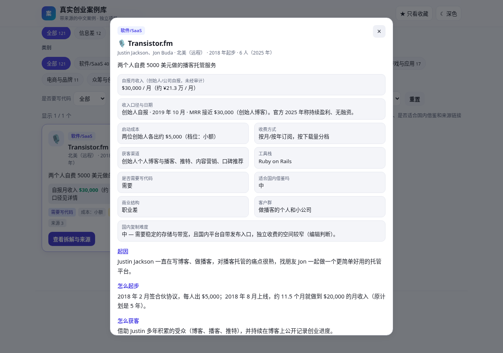

# 真实创业案例库 · Startup Cases (CN)

> 有公开来源的中文创业 / 独立开发 / 小生意案例库：每个案例都附原始来源链接，可按类别、**商业结构**（信息差/流程差/职业差）、是否要写代码、启动成本、**国内复制难度**、自报月收入筛选，支持搜索、收藏和深色模式。

**在线使用：** [https://812822586-droid.github.io/startup-cases-cn/](https://812822586-droid.github.io/startup-cases-cn/)

如果这个项目对你有帮助，请点右上角 **Star ⭐**，让更多人发现它！

> ⚠️ **免责声明（请先读）**
> - 收入数字均为创始人、公司或公开报道**自报**，**未经审计**，本库不做核实担保；
> - 收录的几乎都是做成了的案例，存在严重的**幸存者偏差**（失败的人很少被记录）；
> - 内容仅供学习参考，**不构成投资或创业建议**，也不保证你照做就能赚钱；
> - 美元换算人民币按 1 美元 ≈ 7.1 元粗算，仅作量级参考；
> - 本项目是独立项目，与任何其他网站、数据库**没有隶属或合作关系**。

---

## 截图

### 桌面端


### 手机端


### 案例详情（含收入口径与来源）



---

## 功能

- 🔍 **搜索**：按名称、创始人、国家、获客渠道、工具等即时筛选
- 🏷️ **类别筛选**：11 个类别（软件、AI 工具、游戏、内容、品牌、本地生意等）
- 🧭 **商业结构筛选**（2026-11-10 新增）：信息差 / 流程差 / 职业差 / 其他；每个案例还写了**客户群**和**国内复制难度**（低/中/高 + 一句话理由）
- 🧰 **实用筛选**：是否需要写代码、启动成本档位、国内复制难度、自报月收入档位；可按月收入或起步年份排序
- 📎 **每个案例都有来源链接**，并标明“收入口径与日期”
- ★ **收藏**：保存在浏览器 localStorage，可「只看收藏」
- 📄 **加载更多**：每页 24 个
- ☾ **深色 / 浅色** 模式，📱 手机适配，纯静态、无构建、无 CDN

## 当前内容

本库当前收录 **121** 个案例（以 `cases-data.js` / `cases.json` 为准），其中：

- 有可引用的**自报月收入**数字的：**15** 个（其余要么官方没公开，要么是一次性出售、累计销量等口径不同，**宁可留空也不估算**）
- 标注为“**不需要写代码**”的：**46** 个

| 数量 | 类别 |
|---:|:---|
| 40 | 软件/SaaS |
| 17 | 游戏与应用 |
| 14 | 内容与通讯 |
| 11 | 电商与品牌 |
| 7 | 知识付费与服务 |
| 6 | AI 工具 |
| 6 | 创作者 |
| 6 | 众筹与创意 |
| 5 | 数字产品与模板 |
| 5 | 餐饮与本地生意 |
| 4 | 开发者与开源 |

### 三种商业结构

2026-11-10 起，每个案例都标了“商业结构”，帮你判断钱是从哪种差异里赚来的：

| 数量 | 商业结构 | 含义 |
|---:|:---|:---|
| 12 | 信息差 | 把分散、不透明的信息整理成客户愿意付钱的决策产品（榜单、数据库、评测、订阅分析等） |
| 13 | 流程差 | 把企业或个人的重复劳动自动化/标准化，按项目或按月收费 |
| 29 | 职业差 | 为某一个具体职业或人群做专属的工具、模板、课程和工作流程 |
| 67 | 其他 | 游戏、消费品牌、餐饮、创作者个人品牌等不属于前三类的案例 |

“国内复制难度”分布：低 5 个、中 36 个、高 80 个。这是编辑的简短判断，只是参考，不是结论；多数案例在国内复制难度偏高，是因为合规、资金、平台规则等原因。

## 更新记录 · CHANGELOG

### 2026-11-10

- **新增“商业结构”维度**：每个案例（包括原有 111 个）都增加了 `商业结构`（信息差/流程差/职业差/其他）、`客户群`、`国内复制难度`（低/中/高 + 一句话理由）三个字段；网页新增“商业结构”筛选和“国内复制难度”筛选，案例详情里显示这三项。
- **新增 10 个案例**（总数 111 → 121），重点是低启动成本、一人或小团队、面向企业或某一职业、能重复交付的项目：
  - 信息差：**SparkToro**（受众研究）、**Listen Notes**（播客搜索与数据接口）、**Levels.fyi**（薪资与职级数据）
  - 流程差：**Audience Ops**（产品化内容营销服务）、**Mailparser 与 Docparser**（邮件/PDF 数据抽取）、**Tally**（表单工具，自报 2025 年 10 月 MRR 约 $338K）
  - 职业差：**FeedbackPanda**（在线英语老师写反馈，自报 2019 年 10 月 MRR $55K 后出售）、**Teachers Pay Teachers**（老师互相出售教学资料）、**135编辑器**（公众号排版）、**Studio Ninja**（摄影师业务管理）
- 新案例的事实全部来自创始人博客/官网、Indie Hackers、新闻报道、维基百科等公开来源，文字均为原创中文整理；没有公开收入数字的一律留空。
- 端到端测试新增对商业结构筛选、复制难度筛选和详情字段的检查。

### 2026-11-10（首次发布）

- 发布 111 个案例、11 个类别，支持搜索、筛选、收藏和深色模式。

## 内容是怎么整理的

- **所有案例文字均为原创中文整理**，没有复制、翻译任何网站的文章、访谈、数据库表格或页面设计；事实（产品、创始人、年份、定价方式、自报收入、渠道、工具）来自各条目列出的**公开一手来源**：创始人自己的博客/官网、公开的经营数据页、Indie Hackers 帖子、新闻报道、维基百科等。
- 每个案例至少有 1 个来源链接；收入标明“创始人自报/公司自报”与日期；找不到来源的数字**不写**。
- 不使用任何公司 Logo 或产品截图，只用 emoji 做图标。
- 少数网站会拦截自动访问（例如 Forbes、Fast Company 返回 403），这类链接用浏览器可以正常打开。
- 信息核对日期：2026-11-10。“适合国内借鉴吗”是编辑的简短判断，仅供参考。

## 本地预览

无需安装依赖：

```bash
# 方式一：直接用浏览器打开
open index.html

# 方式二：任意静态服务器（可选）
python3 -m http.server 8080
```

## 贡献一个案例

见 [CONTRIBUTING.md](CONTRIBUTING.md)。简单说：在 `cases-data.js`（并同步 `cases.json`）里追加一个带来源链接的对象，再提 PR。

检查来源链接是否失效：`python scripts/check_sources.py`。端到端测试（Playwright）：`python tests/e2e.py`。

## License

[MIT](LICENSE) © 2026 812822586-droid

---

## English

**Startup Cases (CN)** — a Chinese-language, static-site library of **121** sourced startup / indie-maker / small-business case studies across **11** categories, each tagged with a business structure (information gap / process gap / profession gap / other), a customer group, and a "how hard to replicate in China" rating. Every case links to public primary sources (founder blogs, public dashboards, news, Wikipedia) and is **re-written originally in Chinese** — no text, tables or designs are copied from any other site. Revenue figures are **self-reported and unaudited**, and the library suffers from **survivorship bias**; it is for learning only and is **not** investment or business advice. Features: search, category chips, filters (business structure, needs code or not, startup cost, replication difficulty, self-reported monthly revenue), sort, favorites (localStorage), detail modal, load-more paging, dark mode, mobile layout. No build step.

- Live: https://812822586-droid.github.io/startup-cases-cn/
- This is an independent project, not affiliated with any other website or database.
- Contributions welcome — see `CONTRIBUTING.md`. Star ⭐ if you find it useful!
